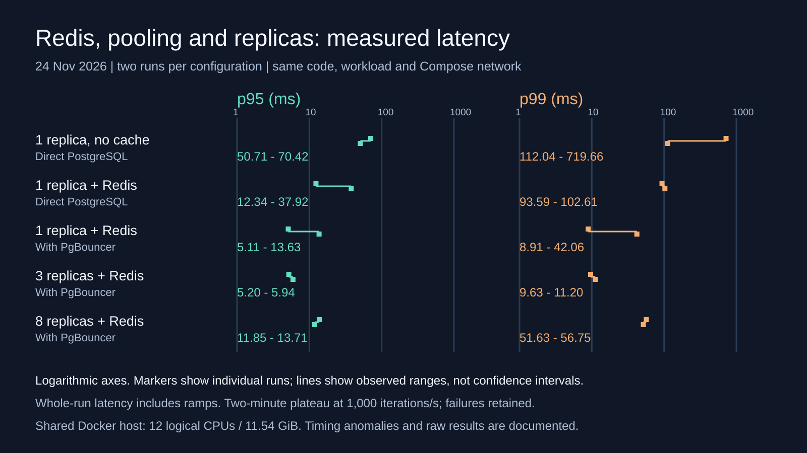
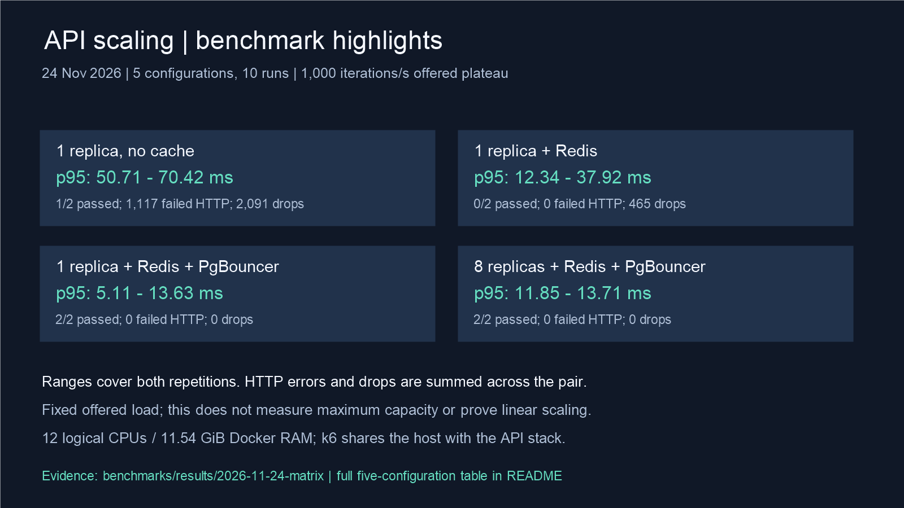
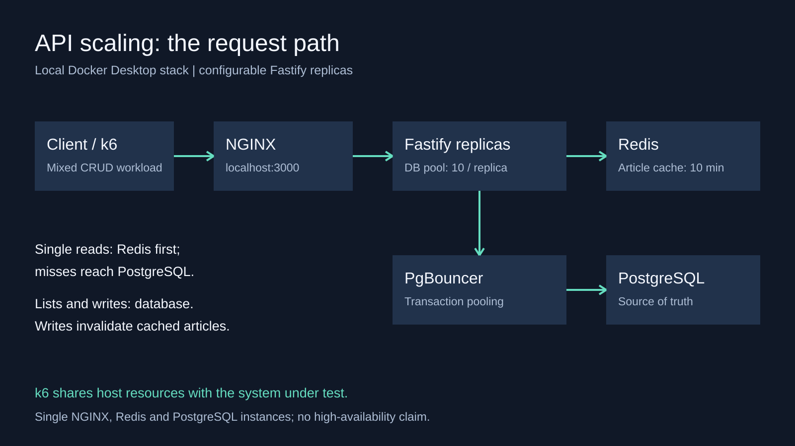

# API scaling with PostgreSQL and Redis

[](https://github.com/arch5d/API_Scaling/actions/workflows/ci.yml)

A Fastify article API and reproducible experiment measuring Redis caching, PgBouncer connection pooling, and API replicas behind NGINX. Includes a seeded PostgreSQL database, a mixed k6 workload, raw benchmark evidence, and shareable architecture/results images.

## Results at a glance

**Fresh controlled comparison: 24 November 2026.** Five configurations, two runs each, the same application image and Compose-network path. Each run has a two-minute plateau targeting 1,000 iterations/s, plus 90 seconds of ramp-up and 30 seconds of cooldown. Every run starts with 100,000 seed articles and an empty Redis cache.

| Config                         | HTTP RPS range | p95 range (ms) | p99 range (ms) |  Failed / total | Drops | Passed |
| ------------------------------ | -------------: | -------------: | -------------: | --------------: | ----: | -----: |
| 1 replica, no cache; direct DB |  733.51–742.30 |    50.71–70.42 |  112.04–719.66 | 1,117 / 354,153 | 2,091 |    1/2 |
| 1 replica + Redis; direct DB   |  740.57–742.50 |    12.34–37.92 |   93.59–102.61 |     0 / 355,898 |   465 |    0/2 |
| 1 replica + Redis + PgBouncer  |  742.70–742.95 |     5.11–13.63 |     8.91–42.06 |     0 / 356,509 |     0 |    2/2 |
| 3 replicas + Redis + PgBouncer |  742.22–742.70 |      5.20–5.94 |     9.63–11.20 |     0 / 356,330 |     0 |    2/2 |
| 8 replicas + Redis + PgBouncer |  742.45–742.62 |    11.85–13.71 |    51.63–56.75 |     0 / 356,361 |     0 |    2/2 |

RPS and percentiles cover each whole four-minute run, including ramps. Ranges show the two observed values, not confidence intervals; failures, request totals and drops are summed across the pair. "Passed" requires zero drops, HTTP failures below 1%, p95 below 250 ms and p99 below 500 ms. [All ten runs and raw logs](benchmarks/results/2026-11-24-matrix/comparison.md) are retained, including failed attempts.

An **iteration** chooses one read, list, or write operation; a delete first creates its own target, so 1,000 iterations/s produces approximately 1,010 HTTP requests/s for this mix. The ramps bring the whole-run average to roughly 742 HTTP requests/s when the offered workload is served.

Redis lowered the observed direct-database tail latencies but did not eliminate drops. PgBouncer passed both one-replica repetitions; all pooled configurations passed both. **Eight replicas had higher tail latency than three at this fixed offered load.** These are fixed-load comparisons, not capacity limits.





[Full method and limitations](benchmarks/CURRENT.md) | [Reproduce the matrix](benchmarks/RUNBOOK.md#controlled-comparison-matrix) | [Download or regenerate images](docs/VISUALS.md)

## Benchmark machine and limitations

Measured environment: Intel Core i5-12450HX, **8 physical cores / 12 logical processors, 24 GiB installed RAM**; Docker Desktop exposed **12 logical CPUs and 11.54 GiB RAM**. Docker Engine 29.5.3, Node.js 22.23.5, k6 2.2.0. Exact image IDs, source hashes and resource snapshots accompany the [benchmark evidence](benchmarks/CURRENT.md#environment-and-provenance).

k6 shares the host and Docker VM with the stack; its 8-CPU / 8-GiB limits do not reserve hardware. Results are two repetitions on a shared development machine, and raw duration minima can be negative in Docker/WSL; originals are unchanged. Both ten-minute confirmation attempts were excluded because the host stalled during them ([details](benchmarks/CURRENT.md#ten-minute-confirmation-attempts-excluded)). The [November 19 results](benchmarks/PROGRESS.md) are a separate historical record.

## Start the stack

Requires Docker with Compose. No `.env` file is needed for this setup: Compose supplies the local service configuration. Run from the repository root:

```sh
docker compose up -d --build --scale api=3
curl http://localhost:3000/health
curl http://localhost:3000/articles/1
```

On Windows PowerShell, use `curl.exe` or `Invoke-RestMethod`. First startup creates and seeds 100,000 articles; initialization takes a little time. Existing database volumes are reused. Compose credentials are local development defaults; published ports bind to loopback.



[Download architecture PNG](docs/images/architecture.png) · [Editable SVG](docs/images/architecture.svg)

Single-article reads use a ten-minute Redis cache. Concurrent misses share a local promise and attempt a Redis fill lock. Writes go to PostgreSQL and invalidate the article's cache entry. Lists bypass Redis. Each replica allows up to ten database connections to PgBouncer, which uses transaction pooling.

## API

| Method | Route                         | Behavior                              |
| ------ | ----------------------------- | ------------------------------------- |
| GET    | `/`                           | Service links                         |
| GET    | `/health`                     | Database probe and local cache state  |
| GET    | `/metrics`                    | Per-process Prometheus metrics        |
| GET    | `/articles?limit=20&offset=0` | Article metadata, newest first        |
| GET    | `/articles/:id`               | Full article, ETag, and cache headers |
| POST   | `/articles`                   | Create; returns 201                   |
| PUT    | `/articles/:id`               | Replace article fields                |
| DELETE | `/articles/:id`               | Delete; returns 204                   |

POST and PUT accept JSON:

```json
{
  "title": "Measuring cache misses",
  "slug": "measuring-cache-misses",
  "body": "A cold read reaches PostgreSQL; subsequent reads use Redis.",
  "authorId": null
}
```

[Documentation.md](Documentation.md) describes validation, configuration, and implementation limits.

## Develop locally

Use Node.js 22.13 or later within the Node 22 release line and npm. Start only the dependencies so the local API can use port 3000:

```sh
docker compose up -d postgres redis
npm ci
```

Create a private local configuration from the checked-in template:

```powershell
# Windows PowerShell
Copy-Item .env.example .env
```

```sh
# macOS / Linux
cp .env.example .env
```

`.env.example` contains public development defaults, not deployment credentials. `.env` and environment-specific variants such as `.env.local` are ignored by Git and excluded from Docker builds. Keep real credentials in your local environment or deployment secret configuration.

Start Node with explicit environment-file loading:

```sh
node --env-file=.env --watch src/server.js
```

`npm start` and `npm run dev` use the process environment; they do not automatically load `.env`. If the full stack is running, stop its API and NGINX services first or choose another local `PORT`.

```sh
npm test
npm run lint
npm run format:check
```

Tests inject database and cache doubles. They do not replace integration checks against Compose.

## Reproduce the benchmark

With k6 installed and the stack running:

```sh
k6 run -e SMOKE=true loadtest/baseline.js
k6 run -e STRESS=true -e ACCESS_PATTERN=realistic loadtest/baseline.js
```

Tests mutate the benchmark database and assume seed IDs 1 through 100,000 exist. The [runbook](benchmarks/RUNBOOK.md) includes Docker execution, cache preparation, replica changes, and evidence capture.

The workload selects 80% single-article reads, 15% list reads, and 5% write operations. Deletes create their own target first, so iterations and HTTP requests are different units. Thresholds cover the whole run, including ramps.

## Scope

This is an unauthenticated scaling experiment, not a production service: no auth, TLS, rate limiting, or high availability. Cache invalidation is best effort, and the measurements establish neither a capacity ceiling nor linear replica scaling. Failed and incomplete runs remain in the [benchmark record](benchmarks/PROGRESS.md). [MIT licensed](LICENSE).

## What I'd do next

- Repeat on a dedicated host with a separate generator; test uniform reads and find a maximum sustainable rate with more runs.
- Address stale-read races and concurrent read/write consistency across replicas.
- Cache list endpoints and test overload behavior.
- Remove single points of failure (NGINX, Redis, PostgreSQL) and aggregate `/metrics` per replica.
