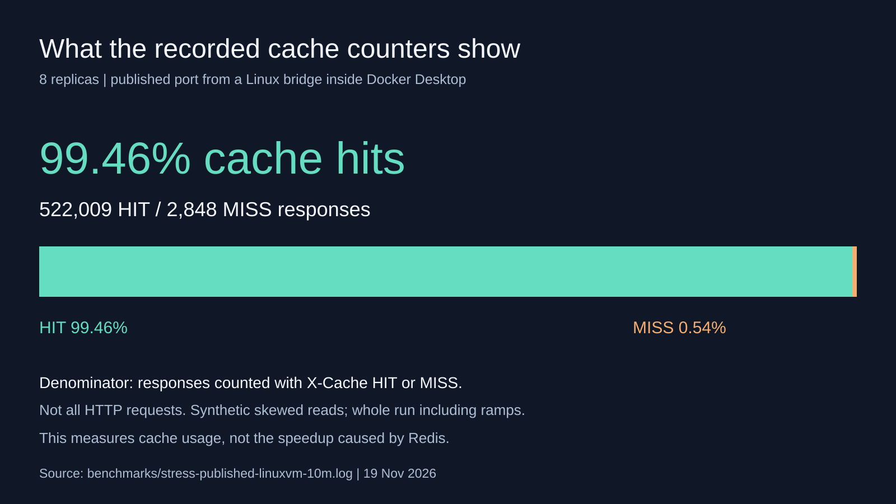
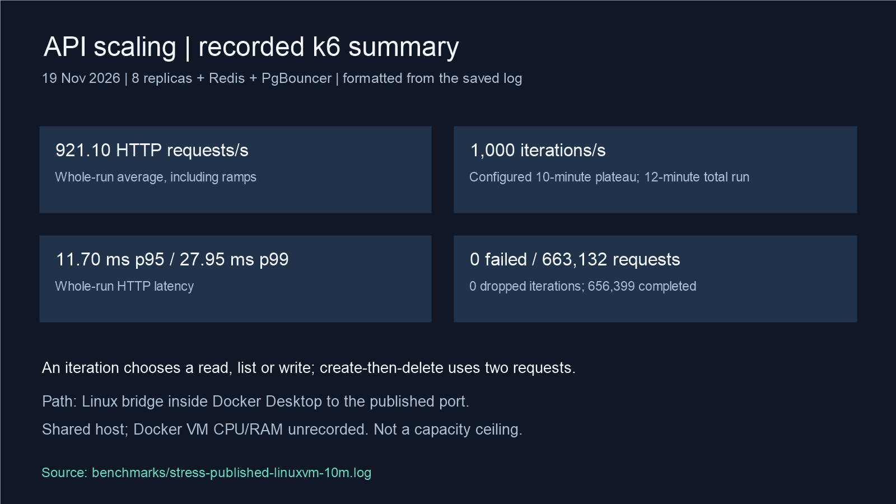

# API scaling with PostgreSQL and Redis

A Fastify article API for measuring Redis cache behavior, database connection pooling, and replication behind NGINX. This repository contains the application, a seeded PostgreSQL database, a k6 workload, and raw results from local Docker Desktop experiments.

The strongest recorded run completed a **10-minute plateau at 1,000 iterations/second**, with zero dropped iterations and zero failed HTTP requests. Whole-run p95 was **11.70 ms** and p99 was **27.95 ms**. It used eight API replicas and a published port accessed from a Linux bridge inside Docker Desktop. This is a local benchmark, not a measured production capacity ceiling. See the [results and qualifications](benchmarks/PROGRESS.md).

## Results at a glance

An **iteration** chooses one read, list, or write operation; a delete first creates its own target, so 1,000 iterations/s means approximately 1,010 HTTP requests/s for this mix, not exactly 1,000 requests/s.

| Config                                                                            |     HTTP RPS |      p95 |      p99 | Errors (failed / total HTTP requests) |
| --------------------------------------------------------------------------------- | -----------: | -------: | -------: | ------------------------------------: |
| 1 replica, no cache                                                               | Not recorded |        — |        — |                                     — |
| 1 replica + Redis                                                                 | Not recorded |        — |        — |                                     — |
| [3 replicas + Redis](benchmarks/stress-internal-10m.log), before PgBouncer        |       920.78 |  7.78 ms | 27.16 ms |                           0 / 662,890 |
| [8 replicas + Redis](benchmarks/stress-published-linuxvm-10m.log), with PgBouncer |       921.10 | 11.70 ms | 27.95 ms |                           0 / 663,132 |

“Not recorded” means no retained raw result for that configuration in the November 19 comparison. Earlier single-instance results survive only as [session recollections](benchmarks/PROGRESS.md#recovered-session-evidence), without the original output needed to verify or compare them.

RPS and percentiles cover the entire 12-minute run, including ramps; both completed a ten-minute plateau targeting 1,000 iterations/s with zero drops. The three-replica run used the Compose network; the eight-replica run used a published port from a Linux bridge inside Docker Desktop and also added ETags and fill coalescing. **These are not controlled before/after measurements.** Redis-only speedup, PgBouncer's effect, and gains from extra replicas remain unmeasured; similar throughput reflects the offered workload, not proven equal capacity.



The chart uses 522,009 hits / (522,009 hits + 2,848 misses). Lists and writes are outside these cache counters. The workload strongly favors a small set of article IDs; this rate is not a prediction for uniform reads or production traffic.



This is a shareable summary rendered from the retained k6 log, not a live terminal screenshot. [Download PNGs and reproduce the visuals](docs/VISUALS.md).

## Benchmark machine and limitations

The recorded environment was Windows with Docker Desktop and Docker Engine 29.5.3. **Docker Desktop CPU allocation and RAM limit: not recorded.** Host CPU model, core count, and installed RAM were also not retained. k6's container was limited to 8 CPUs and 8 GB; those are generator limits, not the Docker VM allocation.

The k6 generator shared the machine with the system under test, competing for CPU, memory, and network resources. These runs do not measure isolated server capacity. Historical hardware details require original session evidence; current settings cannot establish the allocation used then.

A session-history recovery supplied on 21 November found no historical VM allocation or host hardware details. It confirmed that both accepted runs used k6 containers inside the same Docker Desktop VM as the stack; the separate bridge used for the eight-replica run did not provide hardware isolation.

Current environment check (21 November 2026): Docker Engine 29.5.3 reports **12 logical CPUs and 11.54 GiB RAM** (12,389,126,144 bytes) available to Docker Desktop. This is the current engine-visible allocation, not a confirmed allocation for the 19 November runs.

## Start the stack

Requires Docker with Compose. No `.env` file is needed for this setup: Compose supplies the local service configuration. Run from the repository root:

```sh
docker compose up -d --build --scale api=3
curl http://localhost:3000/health
curl http://localhost:3000/articles/1
```

On Windows PowerShell, use `curl.exe` or `Invoke-RestMethod`. First startup creates and seeds 100,000 articles; initialization takes a little time. Existing database volumes are reused. Compose credentials are local development defaults; published ports bind to loopback.


[Download architecture PNG](docs/images/architecture.png) · [Editable SVG](docs/images/architecture.svg)

Single-article reads use a ten-minute Redis cache. Concurrent misses share a local promise and attempt a Redis fill lock. Writes go to PostgreSQL and invalidate the article's cache entry. Lists bypass Redis. Each replica allows up to ten database connections to PgBouncer, which uses transaction pooling.

## API

| Method | Route                         | Behavior                              |
| ------ | ----------------------------- | ------------------------------------- |
| GET    | `/`                           | Service links                         |
| GET    | `/health`                     | Database probe and local cache state  |
| GET    | `/metrics`                    | Per-process Prometheus metrics        |
| GET    | `/articles?limit=20&offset=0` | Article metadata, newest first        |
| GET    | `/articles/:id`               | Full article, ETag, and cache headers |
| POST   | `/articles`                   | Create; returns 201                   |
| PUT    | `/articles/:id`               | Replace article fields                |
| DELETE | `/articles/:id`               | Delete; returns 204                   |

POST and PUT accept JSON:

```json
{
  "title": "Measuring cache misses",
  "slug": "measuring-cache-misses",
  "body": "A cold read reaches PostgreSQL; subsequent reads use Redis.",
  "authorId": null
}
```

[Documentation.md](Documentation.md) describes validation, configuration, and implementation limits.

## Develop locally

Use Node.js 22.13 or later within the Node 22 release line and npm. Start only the dependencies so the local API can use port 3000:

```sh
docker compose up -d postgres redis
npm ci
```

Create a private local configuration from the checked-in template:

```powershell
# Windows PowerShell
Copy-Item .env.example .env
```

```sh
# macOS / Linux
cp .env.example .env
```

`.env.example` contains public development defaults, not deployment credentials. `.env` and environment-specific variants such as `.env.local` are ignored by Git and excluded from Docker builds. Keep real credentials in your local environment or deployment secret configuration.

Start Node with explicit environment-file loading:

```sh
node --env-file=.env --watch src/server.js
```

`npm start` and `npm run dev` use the process environment; they do not automatically load `.env`. If the full stack is running, stop its API and NGINX services first or choose another local `PORT`.

```sh
npm test
npm run lint
npm run format:check
```

Tests inject database and cache doubles. They do not replace integration checks against Compose.

## Reproduce the benchmark

With k6 installed and the stack running:

```sh
k6 run -e SMOKE=true loadtest/baseline.js
k6 run -e STRESS=true -e ACCESS_PATTERN=realistic loadtest/baseline.js
```

Tests mutate the benchmark database and assume seed IDs 1 through 100,000 exist. The [runbook](benchmarks/RUNBOOK.md) includes Docker execution, cache preparation, replica changes, and evidence capture.

The workload selects 80% single-article reads, 15% list reads, and 5% write operations. Deletes create their own target first, so iterations and HTTP requests are different units. Thresholds cover the whole run, including ramps.

## Scope

This is a scaling experiment with an unauthenticated CRUD API. It has no authorization, TLS termination, rate limiting, or production deployment automation. Cache invalidation is best effort; concurrent reads and writes can return stale data. Recorded runs do not establish linear replica scaling or maximum sustainable throughput.

Failed and incomplete runs remain in the [benchmark record](benchmarks/PROGRESS.md). [MIT licensed](LICENSE).

## What I'd do next

- Measure 1 / 3 / 8 replicas with fixed hardware, code, network path and dataset; isolate Redis and PgBouncer changes in separate comparisons.
- Address stale-read races in best-effort cache invalidation and test concurrent reads/writes across replicas.
- Evaluate caching for list endpoints, which currently bypass Redis.
- Add rate limiting and test overload behavior.
- Remove the single NGINX failure point and evaluate PostgreSQL failover and read replicas; Redis is also a single instance.
- Optionally add Prometheus and Grafana, scraping each API replica directly: `/metrics` through NGINX samples different processes rather than aggregating them.
